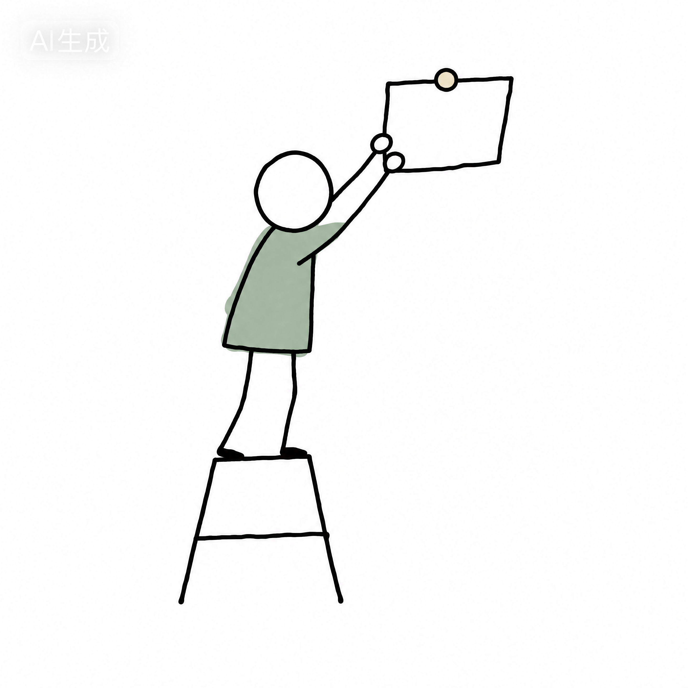

# WLO Handoff v3 — 原文归档与实施状态

来源：用户附件 `dd68e8ad-8bdf-4af4-bff8-6ea8193d05e4/已粘贴的文本.txt`。以下原始交接按用户原文保留，拆分后的 README、TOKENS、SPEC、COPY、MANIFEST 和 logo 已更新。本次仅落实 v3 三处词典变更及序号补零；运行页面验收另由实施记录提供。

源文件 SHA-256：`e197776beb974e9ad88e090323bfe4d610f37fd6eb68664c0ef1f74cd1414d03`。

## v3 实施范围与证据边界（2026-11-07）

本轮只更新 P4 指引插画、代码教鞭、索引单行口径，以及显示序号的补零；其余页面与刚完成的词典内容增强不回退。交接中的固定时长、年份、示例图数字和研究口号不是运行数据。

- 当前公开词表是固定 33 项候选表达中的 Top 20，源于 2,000 份历史招聘归档，公开 60 条去识别的语境释义；词频取自现有数据，不改为示例图的 1,240、34% 或事项分组数字。
- 60 条语境仍标为「归档释义 · 非原文引句」；新增业务场景与交付物标明「举例」「交付示例」。不能把这些材料改成原文引用，也不把未见支持解释为没有支持。
- 词典的解释、例子和交付示例保持当前 `lib/keyword-contexts.ts` 内容；研究页保持已有真实分母、反例与方法说明。模板中的统一「无接口」结论和「含义越弹性，出现的岗位越广」不构成已验证发现。
- 01、09、11 是显示序号；2,000、618、33、频率、日期与耗时是实际计数或值。只给序号补前导零，不给真实计数改值。
- 指引小人的 PNG 原文件完整保存，显示窗口只藏空余画布。线条使用实际测量的元素坐标；中点固定偏移 2.5px，避免渲染抖动；线条不套 multiply。
- 桌面教鞭连接手套端与选中圈的右上开口。手机左轨只有 44px，若仍连接右上开口就无法同时满足短指 ≤20px 和不跨过文字。因此手机小人留在左轨、随选中项上下移动，短指朝向圈的左侧附近；不把这项移动端适配描述为右上开口连线。人物与连线均不得拦截点击。
- 375px 是否无溢出、教鞭锚点是否吻合，须由运行页面实测；本归档文件不宣称视觉验收已经完成。

## 归档说明

- `logo.svg` 只保存 `<svg>` 到 `</svg>`；交接末尾的自然语言说明保留在下方原文归档，不写入 SVG。
- 字体派生名称、OFL 文件、插画使用范围及本地托管说明保留在 [README.md](README.md)；不能由新交接覆盖丢失。
- 原始文档中的模板数字、版权年份和未经验证的概括，均不是数据更新。实际文字以拆分 COPY 的实施说明及当前数据为准。

## 用户原始交接（原样保存）

````text
v3 单文件，直接覆盖旧 WLO-HANDOFF.md 重新上传即可。本轮三处改动都已在文件里标 v3，其余与 v2 一致。
# WLO HANDOFF v3 — 单文件交接包
# 给 Codex 的指令：本文件按 "==== FILE: 路径 ====" 分隔为多个文件，先拆分为 design/ 目录再实现。
# 读取顺序：README → TOKENS.css → SPEC.md → COPY.md → MANIFEST.md → logo.svg
# 硬禁令：禁止从 screenshots/*.png 转录任何文字（图中中文有坏笔画）；文字唯一来源 COPY.md。
# 禁止编造统计数字；占位数字一律 var(--placeholder) 灰字 + .slip 纸条。
# 禁止自绘新小人；缺插画资产时留空并写 TODO，不要补画。
# v3 变更（仅三处，其余同 v2）：
#   1. 词典页指引小人改用 pointer-hand.png（无教鞭版）；教鞭必须由代码按实测锚点绘制，禁止烘进 PNG。
#   2. 索引底部口径行压成一行；禁止整句解释。
#   3. mono 序号一律补前导零（01…33），两位起。

==== FILE: design/README.md ====
# Work Language Observatory — Design Handoff (v3)

本目录是 UI 的唯一设计真相。

## 真相层级（冲突时按序裁决）
1. COPY.md — 界面文字唯一来源。
2. TOKENS.css — 色值/字号/间距/圆角/组件唯一来源。
3. SPEC.md — 结构/状态/交互/断点唯一来源。
4. screenshots/*.png — 仅参考版式节奏与插画位置。
5. illustrations/*.png — 手绘插画唯一来源。
6. logo.svg — 标志唯一来源；改尺寸按模数表重建，不改路径比例。

## 占位与来源规则
- 未证实数字：灰字 var(--placeholder)，区块挂 .slip（「占位」或「假设」）。
- 例子来源仅两种标记：引用 → 灰字 `引用 · 出处`；生成 → .slip「假设」。
- 图表非主证柱必须带图案（斜纹/点/竖线）+ 60% 不透明；信息不得只靠颜色区分。
- 未验证假设挂 .pill「待检验」；反例与支持同字号同位置。
- 真实数据到位前保留钩子：/* TODO(real-data): replace placeholder figures */
- 失败色 var(--sand)，不用红。

## 数字与序号（v3）
- 所有 mono 序号补前导零，两位起：`String(n).padStart(2,'0')`。
  错：`9 适应` / `11 目标`　对：`09 适应` / `11 目标`（≥100 时自然三位，不截断）。
- 计数、频次、日期、时长一律 var(--placeholder) 灰字；正文数字才用 ink。

## 字体（均 SIL OFL 1.1）
中文衬线 Source Han Serif CN（标题/词条/公式标题/引用原句）；中文无衬线 Source Han Sans SC；
英文 Inter，英文标题 Source Serif 4；数字/时间/频次/上标 Roboto Mono。字标上线前转曲。

## 标志模数
viewBox 0 0 24 24，u=1。五个矩形：top x4 y3 w16 h2；stem x4 y3 w2 h11；bottom x4 y12 w16 h2；
inner x7 y7 w9 h4；outer x4 y17 w9 h4。右边全开，端头平切。最小 16px；16px 时 inner/outer 高各 +5%。净空 4u。

## 插画管线 v2（PNG + multiply）
资产为白底 PNG，笔触与截图同源。用法：
  
融合：.illo{mix-blend-mode:multiply} —— 白底自动隐入纸白，无需抠图。
注意：multiply 只用于 PNG。代码绘制的线条（如教鞭 .clerk-stick）直接上 stroke 色，不要套 multiply。
禁令：
- 禁止跨文件 <use href="外部.svg#id">：iOS Safari / WebView 不支持，移动端会整块消失。
- 如确需 SVG：symbol 必须内联进同一 HTML 文档再 <use>。
- 禁止 Codex 自绘新小人；禁止把会随选中项移动的部件（教鞭、连线、指示箭头）烘进 PNG。
尺寸：桌面 90–130px，手机 44–80px；每页 ≤4 处；只放页边/块间缝隙/空状态。
清单见 MANIFEST.md。

## 工作流
分支 design/v13-handoff → 按读取顺序实现 → 每页对照 MANIFEST 截图自检版式 → 文字只取 COPY.md。
不要：OCR 截图文字；新增阴影/渐变/圆角体系；写死占位数字；导航图标换手绘风。

==== FILE: design/TOKENS.css ====
:root{
  --paper:#FCFCFA; --panel:#F7F7F5; --hover:#F2F2EE;
  --ink:#1A1A1A; --grey:#6B6B66; --placeholder:#9A9A92;
  --hairline:#EBEBE6; --slate:#4A6B7C; --sage:#899B8E; --sand:#D9C7A8;
  --chart-neutral:#C9C9C2;
  --sp-1:4px; --sp-2:8px; --sp-3:16px; --sp-4:24px; --sp-5:40px; --sp-6:56px;
  --radius:6px; --hair:1px; --touch:44px;
  --col-read:680px; --col-read-en-label:200px; --margin-m:20px;
  --rail-w:56px;                 /* v3 词典左留轨（手机 44px） */
  --f-serif:"Source Han Serif CN","Source Serif 4",serif;
  --f-sans:"Source Han Sans SC","Inter",sans-serif;
  --f-mono:"Roboto Mono",monospace;
}
.t-h1{font:400 28px/1.3 var(--f-serif);color:var(--ink)}
.t-h2{font:500 16px/1.4 var(--f-sans);color:var(--ink)}
.t-formula{font:400 20px/1.35 var(--f-serif);color:var(--ink)}
.t-body{font:400 15px/1.75 var(--f-sans);color:var(--ink)}
.t-sub{font:400 13px/1.7 var(--f-sans);color:var(--grey)}
.t-mono{font:400 11px/1.4 var(--f-mono);color:var(--grey)}
.t-mono.ph{color:var(--placeholder)}
.btn-primary{height:44px;padding:0 20px;border:0;border-radius:var(--radius);background:var(--slate);color:#fff;font:500 15px var(--f-sans)}
.btn-ghost{height:40px;padding:0 14px;border:var(--hair) solid var(--hairline);border-radius:var(--radius);background:transparent;color:var(--slate);font:400 13px var(--f-sans)}
.pill{display:inline-flex;align-items:center;height:20px;padding:0 8px;border-radius:999px;font:400 11px var(--f-sans)}
.pill--ok{background:color-mix(in srgb,var(--sage) 18%,transparent);color:#3F5442;outline:1px solid color-mix(in srgb,var(--sage) 55%,transparent)}
.pill--draft{background:color-mix(in srgb,var(--sand) 22%,transparent);color:#6B5636}
.pill--fail{background:transparent;color:var(--grey);outline:1px solid var(--hairline)}
.slip{display:inline-block;transform:rotate(-6deg);padding:1px 6px;background:#fff;border:1.5px solid var(--ink);border-radius:2px;font:400 10px var(--f-mono)}
.quote{border-left:2px solid var(--sage);background:var(--panel);border-radius:var(--radius);padding:14px 16px;font:400 14px/1.8 var(--f-serif)}
.quote .hl{background:color-mix(in srgb,var(--sage) 26%,transparent)}
.quote .en{display:block;margin-top:6px;font:400 13px/1.6 var(--f-sans);color:var(--grey)}
.chip-word{background:color-mix(in srgb,var(--sage) 16%,transparent);border-radius:999px;padding:2px 10px;font:400 12px var(--f-sans)}
/* 索引卡系统 */
.card-index{position:relative;max-width:100%;background:#fff;border:var(--hair) solid var(--hairline);
  border-radius:var(--radius);padding:20px;transform:rotate(var(--tilt,-1deg))}
.card-index .tape{position:absolute;top:-8px;left:50%;width:min(70px,18%);height:16px;
  transform:translateX(-50%) rotate(2deg);background:var(--sand);border:1.5px solid var(--ink)}
.card-index .fold{position:absolute;right:8px;bottom:8px;width:14px;height:14px;
  border-left:1.5px solid var(--ink);border-top:1.5px solid var(--ink);background:var(--paper)}
.card-index .peek{position:absolute;right:4px;bottom:-6px}
.card-index .tab{position:absolute;top:-7px;left:14px;width:56px;height:14px;
  border:1.5px solid var(--ink);border-radius:2px}
.tab--ok{background:var(--sage)} .tab--draft{background:var(--sand)} .tab--fail{background:transparent}
/* 手绘笔触 */
.scribble{fill:none;stroke:var(--sage);stroke-width:2;stroke-linecap:round}
.ring{fill:none;stroke:var(--slate);stroke-width:2;stroke-linecap:round}
.arrowline{fill:none;stroke:var(--ink);stroke-width:1.5;stroke-linecap:round}
/* 插画 */
.illo{display:block;mix-blend-mode:multiply}
/* v3 词典左留轨 + 代码教鞭 */
.term-index{position:relative;padding-left:var(--rail-w)}
.clerk{position:absolute;left:0;bottom:8px;width:44px;mix-blend-mode:multiply;pointer-events:none}
.clerk-stick{position:absolute;inset:0;width:100%;height:100%;overflow:visible;pointer-events:none}
.clerk-stick path{fill:none;stroke:var(--ink);stroke-width:1.5;stroke-linecap:round}
.clerk-stick circle{fill:var(--slate)}
.term{min-height:var(--touch);display:flex;align-items:center;gap:8px}
.term .idx{font:400 11px var(--f-mono);color:var(--placeholder);min-width:2ch;text-align:right}
.term .ct{font:400 11px var(--f-mono);color:var(--placeholder);margin-left:auto}
/* 状态/进度 */
.stepper i{width:16px;height:16px;border-radius:50%}
.stepper .done{background:var(--sage)} .stepper .now{outline:2px solid var(--slate)} .stepper .todo{outline:1px solid var(--hairline)}
.progress{display:flex;gap:4px}
.progress i{height:6px;flex:1;border-radius:3px;outline:1px solid var(--hairline)}
.progress .done{background:var(--sage);outline:0}
.drawer{border-top:var(--hair) solid var(--hairline);border-radius:var(--radius) var(--radius) 0 0;background:var(--paper)}
.hairline{border-top:var(--hair) solid var(--hairline)}
/* 防横向溢出 */
@media (max-width:430px){
  .card-index{--tilt:0deg}
  .card-index .tape{width:min(56px,18%)}
  .term-index{--rail-w:44px}
  .clerk{width:36px;bottom:0}
}
/* QA：375px 下必须满足 document.documentElement.scrollWidth === clientWidth；
   不通过先修偏移，禁止用 overflow-x:hidden 掩盖。 */

==== FILE: design/SPEC.md ====
# SPEC v13.3
## 全局
断点 1440/768/390/375。桌面阅读栏 620–680px；手机边距 20px。
顶栏 56px：标志 28px + 品牌双行；导航四项，当前项=灰绿底圆角药丸；右 中/EN 分段。
Quiet strip 28px：左 mono 状态，右 mono 计数（灰字）。
手机底栏 62px 含安全区：四项，几何线性图标 20px + 10px 标签；图标永不手绘。
触控 ≥44px；无 hover 依赖；抽屉/模态一律不用暗遮罩。
长文默认折叠，入口标字数（桌面）；手机 EN 译文默认折叠。
插画一律 ；禁止跨文件 SVG use（iOS 不支持）。
mono 序号一律补前导零（01…33）；计数/频次/日期/时长一律灰字。
手机 ≤430px：卡片不旋转；胶带/折角/探头正内偏移或 ≤6px 微出卡片；任何元素不得超出视口宽。
375px 自检：scrollWidth === clientWidth。

## P1 JD 分析（v13 活版）
输入态：H1 28px 衬线一行，末五字「放回具体工作。」加 .scribble 铅笔下划线；副题五行。
主输入框（桌面 620×260 / 手机 350×220）；左缘 ladder.png（桌面 90–110px；手机 60px 或隐藏）。
「试试示例（假设）」到输入框左下角一条 .arrowline 手绘弯箭头，箭头端 slate 圆点。
字段脚行：左示例链接，右 mono 计数+清空；岗位/公司并排（手机纵排）+「查背景」；
可展开「来源链接与更多分析选项」；主按钮+次入口+两行承诺；按钮下 pair.png（桌面 180px/手机 140px）。
桌面右区 / 手机预览：一词两事项，两张 .card-index（tilt −1.0/+0.8，胶带+折角）；
卡 A hover=第二胶带+⋯；卡间手绘花括号 .arrowline；来源标记：引用 pill / 假设纸条。
生成中：输入只读可见+「已保留」角标；四步 stepper；计时行+纸条「估计」；四段进度条无百分比；reader.png。
失败：sand 左边框面板；stepper 断点 ✕；「输入与草稿已保留，无需重贴」；重试+查看草稿/返回修改；
下方最近成功记录；torn.png。

## P2 结果页
顺序：操作栏（修改/下载/下一份）→ 标题+纸条+定位两句 → 条件条（手机 2×2）→ 公司行+「背景 ▾」
→ 工作链（三步 .arrowline 箭头；手机竖排）→ 页内导航（桌面右边注三项，当前项前手绘箭头）。
任务单元六层，层间 12px，单元间 40px+细线，不套卡片：
① 动作式标题 20px 衬线 ② .quote（¶定位+词高亮；EN 加 .quote .en）③ 说人话三行（对象/行动/用途）
④ 举例+来源标记 ⑤ 交付+.slip「建议」 ⑥ 做得好。
能力四档：pill 明确要求 / pill 优先考虑（+slip「原文截断，不补写」）/ slip 建议 / slip 待确认。
准备：材料两条；面试练习两条（pill 练习+思路行）；「要问对方的」单列。
社会学三行衬线+「展开完整分析 →」。反馈行：赞/踩+「我会怎样理解这个词 ✎」。
桌面原文栏 300px #F7F7F5 常驻，引用同步高亮；手机「拆解/原文」分段，可返回原位置。
边注插画位：ladder.png（事项一旁）/ torn.png（JD 问题旁）。

## P3 我的分析（v12 活版）
记录 = .card-index + 状态文件签 .tab：sage 完整 / sand 草稿 / outline 失败；草稿卡加胶带+折角。
tilt 交替 −0.5/+0.4/−0.4/+0.5/−0.3（手机 0）。卡内：serif 17px 标题 / 13px 灰 公司·mono 日期 / 右 ⋯。
长标题：桌面省略号，手机换行。
筛选选中态 = .ring 铅笔圈（slate 2px，右上开口），其余纯灰字；不用填充药丸。
「新建分析」按钮旁 clerk-card.png（桌面 64px / 手机 48px）。
首卡 hover = 第二胶带 + ⋯ + 标题 .scribble 下划线。末卡右缘 peek.png（头+一手）。
删除确认卡内行内展开（#F7F7F5 底），无模态无遮罩。
空状态：shelf.png + 一行标题 + 三提示 + 双按钮。
搜索无结果：查询保留可编辑 + drawer.png + 清除搜索 + 去词典查该词 + 最近记录两条。

## P4 工作关键词（v3 修订）
桌面左索引 260px：搜索 + 词条列表；每行 .term = mono 序号（补零，min-width 2ch，右对齐）
+ serif 15px 词 + 英文副名 + mono 灰计数（右对齐 margin-left:auto）。行高 ≥44px，行间不加分隔线。
选中词 = .ring 铅笔圈（slate 2px，右上开口），词本身转 slate；禁用填充药丸与左竖条。

### v3 指引小人（替换旧 pointer.png）
资产：pointer-hand.png —— 无教鞭版，手臂末端是连指手套状圆头，即线的锚点。
位置：进 .term-index 的左侧留轨（--rail-w 56px / 手机 44px），不占列表行内空间。
  桌面 bottom:8px 钉容器底；手机 bottom:0，且跟随选中项（见下）。
教鞭：由代码绘制，禁止烘进 PNG（选中项会变，固定笔画追不上）。
  结构：<svg class="clerk-stick"><path/><circle/></svg>，铺满 .term-index，overflow:visible。
  起点 = 小人指尖（相对 .clerk 盒的固定比例点，建议 x≈68%、y≈18%）；
  终点 = 当前选中项 .ring 的右上开口处（ex = ring.left + ring.width*0.72，ey = ring.top）。
  中点加 2–3px 随机偏移，画成二次贝塞尔，像随手一笔；末端 slate 圆点 r≈1.8。
  两端一律 getBoundingClientRect() 实测，不写死坐标；监听 resize / 索引容器 scroll / 选中项变化重算。
  stroke 用 var(--ink)，不套 multiply。
手机端：轨道仅 44px，长线会陡。小人改为贴选中项左下（bottom 跟 .term.is-active 走，不钉容器底），
  线长缩至 ≤20px，呈「随手一指」而非「举旗远眺」。
点击：.clerk 与 .clerk-stick 必须 pointer-events:none，不得吃掉词条点击区。

右正文：词 + .scribble 下划线、频次 + 分母 + 纸条、
「出现在哪些事项」三行（行首 18px 手绘图标位 + 名称 + mono 灰计数 + ›）、
三张 .card-index（tilt −1.2/+0.8/−0.6，胶带+折角；hover 抬起=第二胶带+折角翻开）、
卡一右缘 peek.png、卡间手绘双向箭头 .arrowline、结论 + .scribble 下划线、边注 twocards.png。
### v3 口径行（替换旧整句）
索引底部只保留一行 11px 灰字，取自 COPY.md：
  33 项 · 计数 = 含该词的广告数
禁止写成「在33项候选词中排序。计数表示包含该词的广告数。」这类整句解释。
手机：目录进底部抽屉（无遮罩）；hand.png 贴「目录 ☰」下方，指向上方控件；卡片纵排不横滑。

## P5 研究观察
边注导航 140px 纯灰列表（当前项前手绘箭头）。正文 620px：H1+纸条、副题两行、下载；
问题一行；假设+pill「待检验」；支持=横向条形图（标签左、灰值右、›；首行选中；
最高柱顶 flag.png；页边 .arrowline 指它；轴注仅 n=…）；
反例同权重两行+结论；「可能的不同读法」pill+「补充你的读法 ›」；讨论/方法折叠。
天平叙事：假设旁 scale-empty.png、反例旁 scale-stone.png（同一架天平画两次，横梁由斜转平）。
手机：图表两行式；天平两位保留；目录抽屉无遮罩。

## EN 规范差
1 标题区预留两行高。2 图表标签列 200px。3 手机 EN 译文默认折叠。
品牌双行反转：EN 主行+中文 10px 字距副行；全页中文仅此处+引用原句。

==== FILE: design/COPY.md ====
# COPY（唯一文字来源）
## 品牌与导航
工作语言观察站 / Work Language Observatory
JD 分析 · 我的分析 · 工作关键词 · 研究观察
JD Analysis · My Analyses · Work Keywords · Research Notes
## P1
把招聘里的词，放回具体工作。 / Put hiring words back into the work.
“自驱”“沟通”“抗压”，在不同岗位里意味着什么？粘贴一份招聘描述，查看这些词与哪些职责、协作和工作条件共同出现，再对照其他岗位中的用法。
分析一份 JD / 从一个关键词开始 / 试试示例（假设） / 查背景 / 来源链接与更多分析选项
文本仅用于本次分析，不做训练。 / 结果存到这台设备的「我的分析」。
## P2 结构词
修改这份 JD · 下载 · 分析下一份 · 工作链 · 逐条拆解工作职责 · 这项里的词
层标签：举例 / 交付 / 做得好
能力档：明确要求 / 优先考虑 / 原文截断，不补写 / 建议 / 待确认
可以准备的材料 · 面试可以练什么 · 要问对方的
社会学分析 · 展开完整分析 → · 这份拆解有帮助吗？ · 我会怎样理解这个词 ✎
原文 · 公开招引 ↗ · 公司背景 ▾
## P3
我的分析 · 新建分析 · 搜索岗位或公司 · 全部/完整/草稿/失败
删除这条记录？ / 删除后无法恢复。 / 取消 / 删除
分析过的岗位都会留在这里。 / 只存在这台设备上 / 可随时导出 Markdown / 不会同步给其他人
没有匹配「X」的记录 / 换个岗位词，或去词典查这个词。 / 清除搜索 / 在「工作关键词」里查「X」→
## P4
同一个词，不同的工作要求。 / 保留岗位与原句，比较熟悉的能力词在不同工作中如何被使用。
出现在哪些事项 / 三个语境 / 差异不在能力，在有无接口。 / 看全部语境 → / 词条目录
v3 口径行（索引底部，仅此一行）：33 项 · 计数 = 含该词的广告数
（旧版整句「在33项候选词中排序。计数表示包含该词的广告数。」作废，不得出现）
## P5
招聘如何描绘“合适的人”？
从反复出现的表达出发，观察工作要求如何被写成个人品质，以及这些词语留下了哪些解释空间。
问题 / 假设 / 待检验 / 支持 / 反例 / 讨论 / 方法 · 口径 · 局限 · 参考
含义越弹性，出现的岗位越广。 / 弹性不是充分条件，行业也在筛选。
可能的不同读法 / 补充你的读法 ›
## 状态
分析完成 · 41 秒 / 已存本机 / 草稿已保存 / 已保留 / 分析未完成 / 证据核对中断 · 网络不稳定
输入与草稿已保留，无需重贴。 / 重试 / 查看草稿 / 返回修改 / 历史记录不受本次失败影响。
已等待 42 秒 / 预计约 1 分钟 / 取消并保留草稿
## 页脚
© 2025 工作语言观察站 / 联系与反馈 · 研究伦理
## 规则
引用标记 `引用 · 出处`（灰字无框）；假设标记纸条「假设」。仅此两种。
占位=纸条「占位」+灰字数字。每行 ≤22 汉字；无段落级正文（社会学三行除外）。
序号一律补前导零：01 / 09 / 11 / 33。

==== FILE: design/MANIFEST.md ====
# 截图与资产清单（v3）
## screens/（从画布下载）
desktop-01-home.png      P1 输入态        首页 v13 活版
desktop-02-result.png    P2              结果页 v13 六层任务单元
desktop-03-history.png   P3 列表          我的分析 v12 索引卡活版
desktop-04-dict.png      P4              词典页 v11 索引卡活版
desktop-05-research.png  P5              研究页 v11 天平叙事活版
desktop-06-tokens.png    TOKENS 对照      设计令牌表
desktop-07-logo.png      标志模数         标志规范 A
mobile-01-home.png / mobile-02-result.png / mobile-03-history.png / mobile-04-empty.png
mobile-05-loading.png / mobile-06-fail.png / mobile-07-noresult.png / mobile-08-dict.png
mobile-09-research.png   （对应 v13/v12/v11 各版）
en-01-home.png / en-02-result.png / en-03-dict.png / en-04-research.png
自检只比版式节奏与插画位置；文字以 COPY.md 为准。

## illustrations/（白底 PNG，.illo multiply；代码线条除外）
ladder.png        梯子贴纸小人        P1 输入框左缘
clerk-card.png    捧空白卡小人        P3「新建分析」旁
peek.png          卡后探头            P3 末卡 / P4 卡一右缘
pair.png          背对背举纸双人      P1 按钮下方
pointer-hand.png  举手指引小人（无教鞭）P4 左留轨   ← v3 新增，替代 pointer.png
twocards.png      两手举卡+问号       P4 右页边注
scale-empty.png   空盘下沉天平        P5 假设旁
scale-stone.png   踮脚放石天平        P5 反例旁
reader.png        坐读等钟小人        P1 生成中
torn.png          缺角纸+乱线         P1 失败 / P2 JD 问题旁
drawer.png        看空抽屉小人        P3 搜索无结果
shelf.png         三人空档案架        P3 空状态
flag.png          柱顶插旗小人        P5 最高柱顶
hand.png          指目录的手          P4 手机「目录 ☰」下方
作废：pointer.png（教鞭已烘进图，v3 起不得使用）

## 代码绘制件（非 PNG，见 SPEC P4）
.clerk-stick 教鞭（词典）· .ring 铅笔圈 · .scribble 下划线 · .arrowline 弯箭头/花括号/双向箭头

==== FILE: design/logo.svg ====
<svg xmlns="http://www.w3.org/2000/svg" viewBox="0 0 24 24" width="24" height="24" fill="currentColor" role="img" aria-label="Work Language Observatory">
  <rect x="4" y="3" width="16" height="2"/>
  <rect x="4" y="3" width="2" height="11"/>
  <rect x="4" y="12" width="16" height="2"/>
  <rect x="7" y="7" width="9" height="4"/>
  <rect x="4" y="17" width="9" height="4"/>
</svg>
新资产：pointer-hand.png（无教鞭版，上面那张）下载后改名放进 design/illustrations/，旧的 pointer.png 删掉——它在 SPEC 里已标作废，Codex 若还引用就是没读 v3。
给 Codex 的一句话：读 design/WLO-HANDOFF.md（v3），本次只需改 P4 词典页三处：换 pointer-hand.png、教鞭改代码绘制并按实测锚点连线、口径行压成一行；另全局补 mono 序号前导零。其余不动。
改完把词典页桌面 + 手机各截一张发我，我看线是否真落在圈的右上开口、手机端有没有变成短促的一指、以及 375px 有没有溢出。
````
